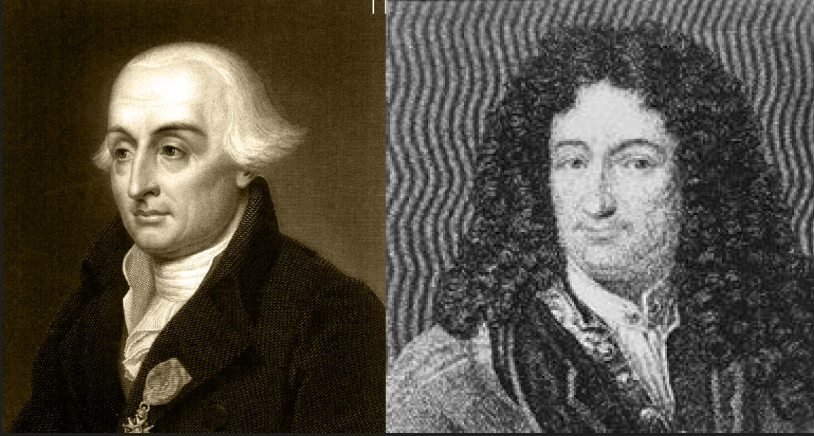

## Bài học:

Để tham chiếu đến định lý, định nghĩa, trước tiên ta cần đặt lệnh 

```latex
\label{}
```

vào môi trường định nghĩa "định lý", "định nghĩa" ...vv... đó.

Để tham chiếu đến môi trường đó ta cần đặt lệnh 

```latex
\ref{}
```

vào . . . 

Ví dụ: . . .

```latex
\documentclass{article}

\usepackage[utf8]{vietnam}

% Useful packages

%  Khai báo màu đường link
\usepackage[colorlinks=true, allcolors=blue]{hyperref}

\usepackage{amsmath}
\usepackage{amsthm}

\theoremstyle{plain}
\newtheorem{theorem}{Định lý}[section]

\begin{document}

\begin{theorem}[Định lý Rolle]
    Cho hàm số $f$ liên tục trên đoạn $[a;b]$ có đạo hàm trên khoảng $(a;b)$ và $f(a) < f(b)$ khi đó tồn tại $c \in (a;b)$ sao cho $f^{'}(c) = 0$
    \label{thm:0.1}
\end{theorem}

\begin{proof}
    Xem ở đây: \url{https://artofproblemsolving.com/wiki/index.php?title=Rolle%27s_Theorem}
\end{proof}

\begin{theorem}[Định lý giá trị trung bình Lagrange]
    Cho hàm số $f$ liên tục trên đoạn $[a;b]$  có đạo hàm trên khoảng $(a;b)$ khi đó tồn tại $c \in (a;b)$ sao cho 
    \[
    f^{'}(c) = \frac{f(b) - f(a)}{b - a} 
    \]
    \label{thm:0.2}
\end{theorem}

\begin{proof}
    . . . 
\end{proof}

Như vậy, định lý \ref{thm:0.2} chính là trường hợp tổng quát của định lý \ref{thm:0.1}.

\end{document}
```

<div align="center">

 

Hai nhà toán học người Pháp Joseph-Louis Lagrange (bên trái) và Michel Rolle (bên phải)

</div> 

--- 

## Câu hỏi

Có hai vấn đề mà mình chưa giải quyết trong phần này: 

**Vấn đề 1** (vấn đề đặt tên): Giả sử ta đang có hai định lý 1.1 và định lý 1.2. Nếu ta thêm một định lý sau định lý 1.1 và trước định lý 1.2 (lúc này sẽ là định lý 1.3 chẳng hạn). Vậy nếu ta để `\label` lúc này ở định lý 1.2 cũ với nội dung là **thm:1.2** , thì ta sẽ phải đổi lại là **thm:1.3**. Điều này sẽ rất phiền phức đối với một tài liệu dài và phải thay đổi liên tục nếu như lỡ sử dụng lệnh `\ref` với nội dung cũ đã bị thay. Vậy có cách nào để tránh tình trạng làm và sửa thủ công này ko ? (nên viết rõ lại câu hỏi cho rõ vấn đề cần hỏi)

Vấn đề này nên được giới thiệu sơ lược ở phần bài học về cách viết [tiên đề, định lý, ..vv..](/Lecture%20notes/theorem,%20definition,%20..vv...md). Cụ thể là phần cách đặt tên cho tên nhãn. Gợi ý câu hỏi vì sao ko nên đặt tên có số như `thm:1.2` chẳng hạn, để phải qua bài học này thì mới biết nhé. 

**Vấn đề 2** (vấn đề tham chiếu với định lý được viết theo tên tác giả): Với định lý có tên dài, chẳng hạn "định lý Gauss - Wantzel" thì làm sao để viết nội dung `\ref` sao cho có đầy đủ tên định lý đó để tham chiếu đến tiêu đề định lý ví dụ như định lý Gauss - Wantzel. 

Nếu chỉ sử dụng lệnh `\label` và `\ref` bình thường, mà lệnh khai báo môi trường định lý đó sử dụng lệnh `\newtheorem*{}{}`, thì hệ thống sẽ báo lỗi vàng (? đây là loại thông báo lỗi gì , quên mất gòi) **Package hyperref: Suppressing empty link**. 

Cách viết ở trường hợp **vấn đề 2** này, chỉ nên được sử dụng khi viết các bài báo dạng ngắn (thuộc lớp article) về vấn đề lịch sử toán học (? khi nào thì nên sử dụng cách viết định lý này)


Để khắc phục được điều này, ta sẽ sử dụng hai lệnh là `\hypertarget` và `\hyperlink` thay thế cho `\label` và `\ref`. 

Xem qua ví dụ (tạm thời) sau: 

```tex
\documentclass{article}

\usepackage[utf8]{vietnam}

%  Khai báo màu đường link
% \usepackage[colorlinks=true, allcolors=blue]{hyperref}
\usepackage{hyperref}
\hypersetup {
    colorlinks = true,
    linkcolor = blue,
    filecolor = magenta,
    urlcolor = cyan,
    pdftitle = {Overleaf Example}, % Tiêu đề của tập tin PDF đầu ra
    pdfpagemode = FullScreen,
}

% . . .
\usepackage{amsthm}

% . . . 
\newtheorem*{thm}{Định lý Gauss--Wantzel}

\begin{document}

\begin{thm}
\hypertarget{thm:gauss-wantzel}
Nội dung định lý Gauss--Wantzel ...
\end{thm}

Theo \hyperlink{thm:gauss-wantzel}{định lý Gauss--Wantzel}, ta có ...

\end{document} 
```