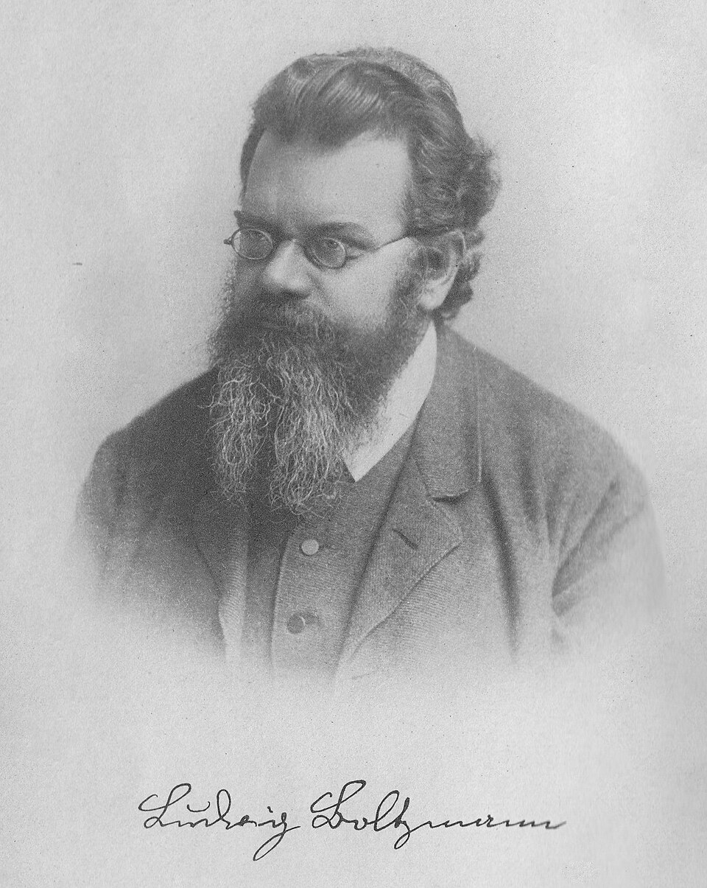

## Bài học: 

### Ý thứ nhất: Chỉ số trên và chỉ số dưới

Để viết chỉ số trên (superscripts) người dùng sử dụng kí hiệu `^`, còn với chỉ số dưới (subscripts) người dùng sử dụng kí hiệu `_` . 

Các kí hiệu chỉ số trên và chỉ số dưới được đặt ở sau kí hiệu, chữ cái toán học. (? viết chưa hợp lí lắm, cần viết lại)

Ví dụ về chỉ số trên với phương trình từ định lý cuối cùng của Fermat được chứng minh bởi nhà toán học Andrew Wiles 

```latex
\documentclass{article}
\usepackage{amsmath}
\begin{document}
\[
x^n + y^n = z^n, \forall x,y,z, n \in \mathbb{Z^+}, n > 2 % chỉ số trên được viết ở cạnh các ẩn số x, y, z
\]
\end{document}
```

Kết quả cho ra được sẽ là:

$$
x^n + y^n = z^n, \forall x,y,z, n \in \mathbb{Z^+}, n > 2
$$

<div align="center">


Nhà toán học người Anh Andrew Wiles

</div>

Ví dụ về chỉ số dưới với phương trình entropy của nhà vật lý Boltzmann thể hiện mối quan hệ giữa entropy và số cách sắp xếp các nguyên tử hoặc phân tử của một hệ nhiệt động nhất định [^1]

```latex
\documentclass{article}
\usepackage{amsmath}
\begin{document}
\[S = k_b \cdot \Omega\] % chỉ số dưới được viết ở biểu thức k_b
\end{document}
```

Kết quả cho ra được sẽ là:

$$
S = k_b \cdot \Omega 
$$

<div align="center">



Nhà vật lý người Áo Ludwig Boltzmann

</div>

--- 

### Ý thứ hai: Gom biểu thức ở chỉ số trên và chỉ số dưới (? đặt tên bài học chán vãi)

Công thức Euler trong số phức: 

$$
e^{i \pi} + 1 = 0
$$

Người dùng có thể thấy để viết được biểu thức $i \pi$ ở chỉ số trên của cơ số $e$, chúng cần được gom lại trong dấu ngoặc nhọn `{}` được đặt sau kí hiệu chỉ số trên. 

Nếu như người viết thông thường 

```latex
e^i \pi
```

thì hệ thống sẽ chỉ hiểu người dùng đang viết $e^i \pi$ thay vì $e^{i \pi}$.   

Điều này cũng được áp dụng tương tự đối với chỉ số dưới. 

Ví dụ . . . với phương trình trường hấp dẫn Einstein mô tả trọng lực không phải là một lực kéo thông thường theo quan điểm vật lý cổ điển của nhà vật lý Isaac Newton, mà là hệ quả của sự uốn cong không-thời gian do khối lượng và năng lượng . . .  gây ra.  

```latex
\documentclass{article}
\begin{document}
\[
R_{\mu\nu} - \frac{1}{2}g_{\mu\nu}R + g_{\mu\nu}\Lambda = \frac{8\pi G}{c^4}T_{\mu\nu} 
\] 
\end{document}
```

$$
R_{\mu\nu} - \frac{1}{2}g_{\mu\nu}R + g_{\mu\nu}\Lambda = \frac{8\pi G}{c^4}T_{\mu\nu} 
$$

Người dùng có thể thấy, để viết được bao quát chỉ số dưới biểu thức $\mu\nu$, chúng cần được viết đấy đủ vào trong dấu ngoặc nhọn `{}` ở sau kí hiệu chỉ số dưới. 

<div align="center">


Nhà vật lý người Đức Albert Einstein

</div> 

---

### Ý thứ ba: Kết hợp chỉ số trên và dưới

Các kí hiệu chỉ số trên và chỉ số dưới cũng có thể được kết hợp trong cùng một biểu thức $C^k_n$ (đọc là tổ hợp chập $k$ của $n$ phần tử) như ở ví dụ về công thức nhị thức Newton giúp khai triển lũy thừa bậc nguyên dương của một tổng thành tổng các đơn thức 

```tex
\documentclass{article}
\begin{document}
\[
(a + b)^n = C_n^k a^{n-k} b^k % . . .C^k_n
\]
\end{document}
```

Kết quả nhận được sẽ là:  

$$
(a + b)^n = C_n^k a^{n-k} b^k
$$

Điều này cũng đúng nếu như ta viết `C_n^k` thành `C^k_n`: 

```tex
\documentclass{article}
\begin{document}
\[
(a + b)^n = C^k_n a^{n-k} b^k % . . .C^k_n
\]
\end{document}
```

Kết quả nhận được cũng sẽ là: 

$$
(a + b)^n = C^k_n a^{n-k} b^k
$$

<div align="center">


Nhà vật lý người Anh Isaac Newton

</div>

---

### Ý thứ tư : Lũy thừa tầng 

Lũy thừa tầng (tetration) là . . . (abcdzyz)

Kí hiệu quen thuộc, ví dụ $x^{m^{n}}$: 

```tex
\[
x^{m^{n}}
\]
```

Tổng quát lên ta có: 

```tex
\[
{}^{n} a = a^{a{^{\cdot^{\cdot^{\cdot^{a}}}}}}
\]
```

$$
{}^{n} a = a^{a{^{\cdot^{\cdot^{\cdot^{a}}}}}}
$$

Kí hiệu lũy thừa tầng của Knuth (còn được gọi là Knuth's up-arrow notation) có dạng: 

$$
a \uparrow^n b = a \underbrace{\mathbin{\uparrow \uparrow \cdots \uparrow}}_{\text{n mũi tên}} b = H_{n+2}(a,b) = a[n+2]b
$$

Viết dưới dạng LaTeX: 

```tex
\[
a \uparrow^n b = a \underbrace{\mathbin{\uparrow \uparrow \cdots \uparrow}}_{\text{n mũi tên}} b = H_{n+2}(a,b) = a[n+2]b
\]
```

---

## Footnote: 

[^1]:  https://en.wikipedia.org/wiki/Boltzmann%27s_entropy_formula
